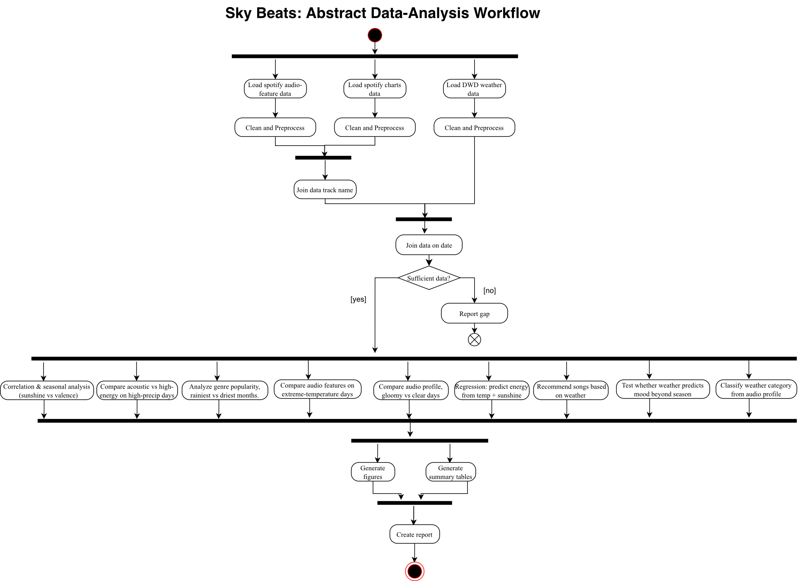

# Requirements

This document specifies the requirements for the *Sky Beats* data-analysis workflow,
which analyses the relationship between **weather/climate in Germany** and the
**mood and audio characteristics of music streamed on Spotify**.

It is structured into:

1. [Functional requirements](#1-functional-requirements): what the workflow does,
   captured as an abstract **UML Activity Diagram** plus supporting descriptions.
2. [Non-functional requirements](#2-non-functional-requirements): qualities and
   constraints the workflow must satisfy that the activity diagram cannot express.
3. [Supplementary documentation](#3-supplementary-documentation): use cases, a data
   dictionary, and assumptions, to add detail where useful.
4. [Component analysis](#4-component-analysis): each action node of the abstract workflow
   mapped to its implementing command-line component (script, method, inputs/outputs) and
   how it is run.

---

## 1. Functional requirements

### 1.1 Goal and research questions

The workflow combines openly available datasets: DWD daily weather observations
(precipitation, sunshine duration, temperature) and two Spotify datasets (daily charts
and per-track audio features) into a single **date-indexed** table and answers the
research questions stated in the [README](../README.md). All datasets are aligned at
**daily** resolution over the common analysis window **2017–2021** (limited by Spotify
charts coverage). In short, it must let us study whether and how daily weather conditions
(sunshine, precipitation, temperature) relate to the audio profile (valence, energy,
danceability, tempo, acousticness, …) of the German Spotify charts.

### 1.2 Abstract workflow: UML Activity Diagram

The activity diagram below describes the workflow at an abstract level. Each **action** is a building block that the
Snakemake workflow will orchestrate. The input datasets are loaded and cleaned
**in parallel**. The two Spotify datasets are joined on Spotify track ID, after
which weather is joined on calendar date. The workflow retains a song-level
table and also derives a daily audio profile for analyses that operate at daily
resolution. Each research question then renders its own figures, tables, and
interpretive reporting notebook.



> The diagram (`docs/workflow_activity_diagram.png`) is exported from
> [draw.io](https://app.diagrams.net) and renders inline on Git.UP.
>
> **Terminology note:** the diagram's “Join data track name” action denotes the
> Spotify-dataset join. The actual and required join key is `track_id`, not the
> human-readable track name. “Create report” denotes the collection of
> per-research-question reporting notebooks; it does not imply a separate,
> monolithic report artifact.
>
> **Snakemake execution boundary:** raw-data acquisition and integration are
> shown to document the complete conceptual workflow, but they run as optional
> preparation commands outside Snakemake. The default Snakemake workflow starts
> from the three committed example inputs, avoiding a roughly 3 GB download and
> allowing graders to reproduce every analysis without network access.

#### Supporting activity diagrams

The general preprocessing flow is shown in the
[preprocessing activity diagram](preprocessing_activity_diagram.png). Detailed
activity diagrams for the individual analyses are collected under
[`docs/research_questions/`](research_questions/README.md):

[RQ1](research_questions/rq1_activity_diagram.png) ·
[RQ2](research_questions/rq2_activity_diagram.png) ·
[RQ3](research_questions/rq3_activity_diagram.png) ·
[RQ4](research_questions/rq4_activity_diagram.png) ·
[RQ5](research_questions/rq5_activity_diagram.png) ·
[RQ6](research_questions/rq6_activity_diagram.png) ·
[RQ7](research_questions/rq7_activity_diagram.png) ·
[RQ8](research_questions/rq8_activity_diagram.png) ·
[RQ9](research_questions/rq9_activity_diagram.png)


### 1.3 Functional requirements list
 
| ID | Requirement |
|----|-------------|
| FR-1 | The workflow shall acquire DWD daily climate observations for Germany (precipitation, sunshine duration, mean air temperature), parse the files, replace documented missing-value sentinels, and aggregate the available stations into a single daily national weather series. |
| FR-2 | The workflow shall load the Spotify daily charts and restrict them to the German region. |
| FR-3 | The workflow shall load per-track Spotify audio features and provide one canonical record per track. |
| FR-4 | The workflow shall join chart entries to their audio features using Spotify track ID and retain the resulting song-level records. |
| FR-5 | The workflow shall join weather to song-level Spotify records on calendar date and derive a daily analysis table by aggregating the required audio features. |
| FR-6 | The workflow shall validate that each analysis input has the required schema and sufficient date coverage, and shall report detected gaps. |
| FR-7 | The workflow shall compute correlations between weather variables and audio features, including a per-season breakdown. |
| FR-8 | The workflow shall compare audio profiles between weather-defined day categories (e.g. gloomy vs clear days, extreme-temperature vs mild days). |
| FR-9 | The workflow shall compare music/genre popularity between the rainiest and driest months. |
| FR-10 | The workflow shall fit and evaluate a model predicting an audio feature (e.g. energy) from weather variables. |
| FR-11 | The workflow shall render the analysis outputs as figures and summary tables in `results/`. |
| FR-12 | The workflow shall provide a reporting notebook for each research question that interprets its generated outputs. |
| FR-13 | Every workflow step shall be runnable as a command-line component so the Snakemake engine can orchestrate it. |
| FR-14 | The workflow shall recommend representative tracks for supplied weather conditions based on the learned weather–audio relationship. |
| FR-15 | The workflow shall evaluate whether weather features improve mood (valence) prediction beyond a season/month-only baseline by comparing the models on held-out data. |
| FR-16 | The workflow shall train and evaluate a classifier that predicts a day's weather category (e.g. gloomy vs clear) from its aggregated audio profile. |
| FR-17 | The recommendation component may optionally obtain current conditions from a documented weather API; the core recommendation workflow shall remain usable with weather values supplied locally. |

## 2. Non-functional requirements

| ID | Category | Requirement |
|----|----------|-------------|
| NFR-1 | **Reproducibility** | The full analysis must be reproducible from the committed example inputs to results via a single Snakemake invocation, with deterministic outputs given the same inputs, configuration, and software environment (all stochastic steps must use pinned random seeds). Raw-data acquisition and preparation are separate reproducible preparation steps because the original Spotify download is approximately 3 GB. |
| NFR-2 | **Environment / portability** | All dependencies must be version-constrained and installable into an isolated environment using `requirements.txt`, so the workflow runs on Linux/macOS and, where feasible, Windows (via WSL), without manual setup. |
| NFR-3 | **Configurability** | Key parameters (date range, region, "gloomy day" thresholds, output paths) must be configurable via a config file / CLI options rather than hard-coded. |
| NFR-4 | **Modularity** | Each component must do one thing well and be a separate, reusable module with a clean command-line interface (per the "10 simple rules to make a software tool workflow-ready"). Each module must be independently runnable and testable: it must produce meaningful output when called in isolation with valid inputs, without requiring the full pipeline to have run first. |
| NFR-5 | **Data provenance & licensing** | Data sources, versions, and licenses must be documented. DWD data (CC-BY-4.0) must be attributed to the Deutscher Wetterdienst; Spotify datasets must be used in line with their ODbL terms. Because ODbL's share-alike clause propagates to derivatives and CC-BY-4.0 is ODbL-compatible, the **merged dataset is published under ODbL v1.0**. Raw data is git-ignored; only example/sample data is committed. A `data/README.md` must document download instructions, checksums, and the retrieval date or earliest verifiable snapshot date of each committed dataset. |
| NFR-6 | **Quality assurance** | Components must include input validation, error handling, logging, and automated tests covering core functionality, including at least one test per component covering the happy path and one covering invalid or missing input. |
| NFR-7 | **Performance / scalability** | The workflow must handle multi-year daily data (charts dataset is large, ~10⁷ rows) within 60 minutes on a standard laptop (8 GB RAM), with peak memory usage below 4 GB per step, e.g. by filtering early and using efficient joins. |
| NFR-8 | **Usability & documentation** | The README and component docs must explain how to install, configure, run, and reproduce results; outputs must be self-describing. All figures and tables must include axis labels, units, and a caption sufficient to interpret the output without reading the source code. |
| NFR-9 | **Maintainability & style** | Code must follow a consistent style (PEP 8, enforced via `flake8` or `ruff`), with readable naming and structure following the standard project template. |
| NFR-10 | **Privacy / ethics** | Only aggregate, non-personal listening data is used; no individual user data is processed. |
| NFR-11 | **Robustness** | Missing values, station gaps, failed station downloads, and unmatched track joins must be handled without silently corrupting results. Missing-value sentinels must be converted to null values, skipped stations must be counted, and merge row counts must be logged. |
| NFR-12 | **Analytical transparency** | Known confounds (COVID-19 period and seasonal cultural events such as Christmas, Oktoberfest, and Fasching) must be documented in the project limitations and relevant result interpretations so readers can assess their influence on conclusions. |

### 2.1 Verification criteria

The following checks make the non-functional requirements objectively
assessable. A requirement is satisfied only when its corresponding evidence is
present; an unexecuted check is not treated as evidence of compliance.

| Requirement(s) | Verification method and required evidence |
|----------------|-------------------------------------------|
| NFR-1 | Clone into a clean directory, install the declared environment, run `snakemake --cores 1`, save the successful run log, then force a second run and compare output checksums. |
| NFR-2 | Install solely from the declared dependency file in a fresh environment on each claimed platform; record Python and OS versions. |
| NFR-3, NFR-4 | Inspect CLIs with `--help`, run each component independently with explicit inputs/outputs, and confirm parameters are read from CLI/config rather than hard-coded paths. |
| NFR-5 | Check `README.md` and `data/README.md` for source URLs, licences, attribution, retrieval dates, checksums, and regeneration instructions. |
| NFR-6, NFR-11 | Run `pytest`; retain the test summary and coverage report. Tests must exercise valid, invalid, missing, and unmatched input cases and verify emitted log messages. |
| NFR-7 | Time and profile a clean full-data workflow run on documented 8 GB hardware; retain per-rule runtime and peak-memory measurements. |
| NFR-8 | Follow the README from a clean clone and review every generated figure/table against an output checklist covering labels, units, captions, and destination paths. |
| NFR-9 | Run the declared linter over `src/`, `tests/`, and workflow Python code with zero reported violations. |
| NFR-10 | Inspect input schemas and provenance documentation to confirm that no user-level or personally identifiable listening data is processed. |
| NFR-12 | Confirm that the README and relevant result notebooks discuss the named temporal and cultural confounds. |


## 3. Supplementary documentation

This section adds detail that the diagram and requirement lists do not capture: how the
workflow is used, the concrete data fields it consumes, the meaning of derived concepts,
and the assumptions the analysis rests on.

### 3.1 Use cases

**UC-1: Reproduce the weather–music analysis**

| Field | Description |
|-------|-------------|
| **Actor** | Researcher / grader |
| **Goal** | Regenerate all analysis figures and tables from the committed example inputs. |
| **Precondition** | Repository cloned; environment installed; committed example inputs available under `data/`. |
| **Main flow** | 1. Configure the analysis parameters and thresholds. 2. Run the Snakemake workflow. 3. The workflow validates, preprocesses, and analyses the prepared inputs. 4. Figures and summary tables appear in `results/`; reporting notebooks interpret them. |
| **Postcondition** | All declared results are reproducibly regenerated from the inputs. |
| **Alternative flow** | If date coverage is insufficient (decision node "Sufficient data?"), the workflow reports the gap and the actor adjusts the configured range / adds data. |

**UC-2: Recommend songs for current weather**

| Field | Description |
|-------|-------------|
| **Actor** | End user |
| **Goal** | Get a playlist that fits today's weather. |
| **Precondition** | The weather–audio model / lookup has been built by the main workflow. |
| **Main flow** | 1. The user supplies weather and calendar values in `config/configuration_w7.yaml`. 2. Trained models predict a target audio profile. 3. The recommender returns catalog tracks nearest to that profile in scaled audio-feature space. |
| **Postcondition** | A ranked list of recommended tracks is returned. |

### 3.2 Data dictionary (key fields)

| Source | Field | Meaning |
|--------|-------|---------|
| DWD (daily) | `MESS_DATUM` | Observation date (YYYYMMDD) |
| DWD (daily) | `RSK` | Daily precipitation height (mm) |
| DWD (daily) | `SDK` | Daily sunshine duration (h) |
| DWD (daily) | `TMK` | Daily mean air temperature (°C) |
| DWD (daily) | `STATIONS_ID`, `QN_*` | Station identifier and quality-level flags |
| Charts | `date`, `region` | Chart day and country (filter `region == "Germany"`) |
| Charts | `title`, `artist` | Song / artist name; `url` is parsed into `track_id` (the actual join key, see below) |
| Charts | `rank`, `streams` | Chart position (1–200) and daily stream count |
| Tracks | `track_name`, `artists` | Song / artist name |
| Charts/Tracks | `track_id` | Spotify track ID — extracted from the charts' `url` column and matched against the tracks dataset's own `track_id`; this is the actual join key used by `merge_spotify.py`, not song title |
| Tracks | `valence`, `energy`, `danceability`, `tempo`, `acousticness` | Per-track audio features |
| Tracks | `track_genre` | Track genre label (114 genres) |

### 3.3 Derived concepts

- **Daily audio profile**: unweighted mean of each audio feature across the matched chart tracks for a date, giving one row per day. Weather values are retained once per date.
- **Gloomy day**: a day at or below the configured low sunshine percentile and at or above the configured high precipitation percentile.
- **Clear day**: a day at or above the configured high sunshine percentile and at or below the configured low precipitation percentile.
- **Extreme-temperature day**: a day whose mean temperature deviation from the corresponding calendar-month mean falls in a configured lower or upper percentile tail.

## 4. Component analysis

For each **action node** in the [activity diagram](#12-abstract-workflow-uml-activity-diagram),
the table below records its operation, inputs, outputs, **implementation strategy**, and
whether the chosen tooling is **runnable locally** (noting any setup caveats).
Because Snakemake orchestrates command-line tools, every component is exposed via an
`argparse` CLI with a side-effect-free `--help` interface.
Implementation is one of three kinds:

- **Existing CLI tool**: a ready-made command-line tool we can call directly.
- **Wrapper**: a thin command-line script we write around an existing library/API.
- **Own implementation**: a new command-line tool we write (with `argparse`), kept as a
  separate module in `src/` with tests and error handling.


> **Note:** All configuration values are read from `config/config.yaml` (per-research-question
> settings are namespaced `rq1 … rq9`). Component scripts live under `src/data/` (acquisition &
> shared preprocessing), `src/common/` (shared helpers `utils.py` + plot styling), and
> `src/rq1/ … src/rq9/` (one folder per research question). The whole pipeline is orchestrated by
> Snakemake (`workflow/Snakefile` + `workflow/rules/`) and run from the project root with a single
> `snakemake --cores 1`. Edit `config/config.yaml` rather than the scripts.

## 4.1 Data Acquisition

| Node (operation) | Input(s) | Output(s) | Implementation | Runnable locally? |
|------------------|----------|-----------|----------------|-------------------|
| Load DWD weather data | `config["dwd"]["base_url"]`, `config["dates"]["start"]`, `config["dates"]["end"]` | raw per-station daily ZIPs (precipitation, sunshine, temperature) | **Own CLI** : `load_weather.py` (Python + `requests`) fetches station index and downloads each ZIP directly from DWD open-data server | Yes : `pip install requests pandas tqdm pyyaml`; needs internet |
| Load Spotify charts data | `config["spotify"]["charts_dataset"]`, `config["spotify"]["source"]`, `config["paths"]["raw_dir"]` | raw daily charts CSV in `data/raw/` | **Wrapper** : `src/data/load_spotify.py` downloads from the team's **Box.UP** public share by default (`requests`, no login), or from Kaggle (wraps the [`kaggle`](https://github.com/Kaggle/kaggle-api) CLI) when `source: kaggle` | Yes : needs internet; Kaggle source also needs an API token at `~/.kaggle/kaggle.json` |
| Load Spotify audio-feature data | `config["spotify"]["features_dataset"]`, `config["spotify"]["source"]`, `config["paths"]["raw_dir"]` | raw per-track audio-feature CSV in `data/raw/` | **Wrapper** : same `src/data/load_spotify.py` (Box.UP or Kaggle) | Yes : same setup as above |

## 4.2 Cleaning & Preparation

| Node (operation) | Input(s) | Output(s) | Implementation | Runnable locally? |
|------------------|----------|-----------|----------------|-------------------|
| Clean & aggregate weather to daily series | raw per-station ZIPs, `config["dwd"]["columns"]`, `config["dates"]["start/end"]` | `dwd_daily_germany.csv`: date, precipitation_mm, sunshine_hours, temperature_mean_c | **Own** : `load_weather.py` (pandas); replaces DWD missing value flag (`-999`) with NaN, averages across all stations per day | Yes : `pip install requests pandas tqdm pyyaml` |
| Filter charts to Germany & extract track ID | `config["spotify"]["charts_file"]`, `config["spotify"]["region"]` | German chart entries with track ID extracted from Spotify URL | **Own** : `merge_spotify.py` (pandas); filters `region == "Germany"`, extracts track ID from URL column | Yes : `pip install pandas tqdm pyyaml` |
| Filter to get track name & audio features | `config["spotify"]["features_file"]`, `config["spotify"]["audio_features"]` | canonical deduplicated track → audio-feature table | **Own** : `merge_spotify.py` (pandas); drops duplicate track IDs, keeps only columns listed in `config["spotify"]["audio_features"]` | Yes : `pip install pandas tqdm pyyaml` |

## 4.3 Integration

| Node (operation) | Input(s) | Output(s) | Implementation | Runnable locally? |
|------------------|----------|-----------|----------------|-------------------|
| Join charts to audio features on track ID | `config["spotify"]["charts_file"]`, `config["spotify"]["features_file"]` | `config["spotify"]["output_file"]` (`spotify_germany.csv`); unmatched rows dropped | **Own** : `merge_spotify.py` (pandas `merge` on `track_id`, `how="left"`); drops rows with missing audio features | Yes : `pip install pandas tqdm pyyaml` |
| Join songs to weather on date | `config["spotify"]["output_file"]`, `config["dwd"]["output_file"]`, `config["dates"]["start/end"]` | `config["merge"]["output_merged"]` (`spotify_weather_merged.csv`) : all songs with weather columns · `config["merge"]["output_daily"]` (`spotify_weather_daily_merged.csv`) : daily-aggregated audio profile + weather | **Own** : `merge_weather_spotify.py` (pandas `merge` on `date`, `how="left"`; plus a `groupby("date")` aggregation for the daily output) | Yes : `pip install pandas tqdm pyyaml` |
| General preprocessing & data-sufficiency check *("Sufficient data?" decision)* | song grain: `spotify_weather_merged.csv` · daily grain: `spotify_weather_daily_merged.csv` | song grain → `spotify_weather_merged_processed.csv` (consumed by RQ1–RQ6, RQ8, RQ9) · daily grain → `spotify_weather_daily_merged_processed.csv` (consumed by RQ7). Both: parsed dates, numeric coercion, median-fill, calendar columns (`year`/`month`/`day`/`weekday`/`is_weekend`/`season`) | **Own** : `src/data/dataprocessing.py` (pandas), one shared script selected via `--schema {song,daily}`; validates the schema's required columns and a **contiguous** daily date range before any analysis runs | Yes : pure Python |
| Report gap & stop *(`[insufficient]` branch)* | validation result from `dataprocessing.py` | error listing missing / non-contiguous dates; the run stops | **Own** : `dataprocessing.py` raises on invalid or gappy input (the diagram's flow-final on the `[insufficient]` edge) | Yes : pure Python |


## 4.4 Analysis & Visualisation (per research question)

Every component below is an **own** Python command-line tool (`argparse`) kept as a separate
module under `src/rq1/ … src/rq9/`, with input validation, logging, and automated tests. All are
**runnable locally** after `pip install -r requirements.txt` (no network needed once the example
data in `data/` is present). Rules tagged `{feature}` run once per audio feature via Snakemake
wildcards.

| RQ | Node (operation) | Component(s) · method | Input → Output (under `results/workflow_N/` unless noted) |
|----|------------------|-----------------------|-----------------------------------------------------------|
| RQ1 | Correlation & seasonal analysis (sunshine vs valence) | `datapreprocessing_w1.py` (daily profile via `utils.aggregate_daily`, + season labels) → `sunshine_valence_correlation.py` (Spearman ρ overall + per season, `scipy`) → `plot_sunshine_valence.py` (2×2 seasonal scatter, `matplotlib`) | `…_processed.csv` → `…_w1.csv` → `sunshine_valence_correlation.csv` → `sunshine_valence_by_season.png` |
| RQ2 `{feature}` | Bucket precipitation into 4 categories; Kruskal-Wallis + Dunn's post-hoc across buckets; Spearman correlation against continuous precipitation; per-feature box plot, scatter, and annotated bar plot | `datapreprocessing_w2.py` (4-bin percentile bucketing + period labels) → `kruskal_wallis.py` (H-test + Dunn's Bonferroni + ε², `scipy`+`scikit-posthocs`) → `kruskal_report.py` (box plot + markdown) → `spearman_correlation.py` (Spearman ρ + 95% CI + effect size, `scipy`) → `spearman_report.py` (scatter, trend, markdown, and bucket-mean bar plot) | `…_processed.csv` → `…_w2.csv` → `kruskal_{feature}.json` → `kruskal_report_{feature}.png`, `kruskal_report_{feature}.md` → `spearman_{feature}.json` → `spearman_report_{feature}.png`, `spearman_report_{feature}.md` → `bar_plot_{feature}.png` |
| RQ3 | Analyze genre popularity, rainiest vs driest months | `genre_shift.py` (rank N rainiest/driest months by precipitation; per-genre stream- & count-share shift, `pandas`) → `plot_genre_shift.py` (top-N shifts, `matplotlib`) | `…_processed.csv` → `genre_shift.csv` → `genre_shift.png` |
| RQ4 `{feature}` | Compute temperature deviation from monthly mean; flag Cold/Normal/Hot extreme days (5th/95th percentile); Kruskal-Wallis + Dunn's post-hoc across 3 groups; OLS regression on absolute deviation magnitude; per-feature box plot and scatter regression report | `datapreprocessing_w4.py` (temperature deviation + 5th/95th extreme flags + binary Hot/Cold column + period labels) → `kruskal_extremes_w4.py` (H-test across Cold/Normal/Hot + Dunn's Bonferroni + ε², `scipy`+`scikit-posthocs`) → `kruskal_report_w4.py` (box plot + markdown) → `deviation_magnitude_regression_w4.py` (OLS on abs deviation + slope + R² + effect size, `statsmodels`) → `deviation_magnitude_regression_report_w4.py` (scatter + OLS trend + markdown) | `…_processed.csv` → `…_w4.csv` → `kruskal_extremes_{feature}.json` → `kruskal_extremes_{feature}.png`, `kruskal_extremes_{feature}.md` → `abs_dev_regression_{feature}.json`, `abs_dev_regression_{feature}.txt` → `abs_dev_regression_{feature}.png`, `abs_dev_regression_{feature}.md` |
| RQ5 | Two tracks — Track 1: TimeSeriesSplit CV comparing mean baseline, persistence baseline, linear regression, and gradient boosting on daily energy; Track 2: VIF-checked nested OLS with seasonal weather interactions, F-test, seasonal slope extraction, per-predictor seasonal effect plots | **Track 1:** `predict_energy_w5.py` (daily aggregation; 5-fold `TimeSeriesSplit` CV; `LinearRegression` + `GradientBoostingRegressor` vs baselines; R²/RMSE/MAE, `scikit-learn`) → `predict_energy_report_w5.py` (R² bar chart + markdown verdict) **‖ Track 2:** `datapreprocessing_w5.py` (season derivation) → `regression_energy.py` (VIF check + iterative drop; Model 1 vs Model 2 OLS; `anova_lm` F-test; seasonal slopes; simple train/test metrics, `statsmodels`+`scikit-learn`) → `seasonal_effect_line_plot.py` (predicted energy vs predictor, one line per season, `matplotlib`) | **Track 1:** `…_processed.csv` → `predict_folds.csv`, `predict_summary.json` → `predict_report.png`, `predict_report.md` **‖ Track 2:** `…_processed.csv` → `…_w5.csv` → `coefficients.csv`, `vif.csv`, `comparison.csv`, `seasonal_slopes.csv`, `significance.txt`, `predictive_metrics.csv` → `plot_{predictor}.png` (×3) |
| RQ6 | Compare audio profile, gloomy vs clear days | `datapreprocessing_w6.py` (daily profile + percentile gloomy/clear labels, `utils.label_gloomy_clear`) → `audio_profile.py` (per-feature means + Mann–Whitney U, `scipy`) → `plot_audio_profile.py` (radar chart, `matplotlib`) | `…_processed.csv` → `…_w6.csv` → `profile_comparison.csv` → `audio_profile_radar.png` |
| RQ7 | Predict daily music mood from weather, recommend matching songs | `dataprocessing.py --schema daily` (shared validate + median-impute) → `datapreprocessing_w7.py` (calendar/holiday features, `holidays`) → `train_model.py` (Ridge/RandomForest/HistGradientBoosting comparison per mood target, `scikit-learn`+`joblib`) → `recommend_song.py` (k-NN song match on predicted mood, `scikit-learn`) ∥ `plot_results.py` (feature-importance plots, `matplotlib`+`seaborn`) | `spotify_weather_daily_merged.csv` → `spotify_weather_daily_merged_processed.csv` → `spotify_weather_daily_processed.csv` → `weather_model.pkl`, `weather_metrics.csv` → `song_recommendations.csv`, `feature_importances.png` |
| RQ8 | Test whether weather predicts mood beyond season | `datapreprocessing_w8.py` (daily profile + month/season features) → `compare_models_w8.py` (weather vs season-only baseline; Ridge + RandomForest; chronological split, `scikit-learn`) → `plot_model_comparison.py` (grouped R²/MAE bars, `matplotlib`) | `…_processed.csv` → `…_w8.csv` → `model_comparison.csv` → `model_comparison.png` |
| RQ9 | Classify weather category from audio profile | `datapreprocessing_w9.py` (daily profile + gloomy/clear labels, two-class filter) → `train_classifier.py` (LogReg + RandomForest vs majority baseline, stratified CV, `scikit-learn`+`joblib`) → `plot_classifier.py` (confusion matrix + importances, `matplotlib`) | `…_processed.csv` → `…_w9.csv` → `metrics.csv`, `classifier_model.pkl`, `predictions.csv`, `feature_importance.csv` → `classifier_report.png` |

## 4.5 Reporting

| Node (operation) | Input(s) | Output(s) | Implementation | Runnable locally? |
|------------------|----------|-----------|----------------|-------------------|
| Generate figures | per-RQ analysis outputs | PNG figures under `results/workflow_N/` | **Own** plot scripts (`matplotlib`/`seaborn`), listed in §4.4 | Yes; installed through `requirements.txt` |
| Generate summary tables | per-RQ analysis outputs | CSV / JSON / Markdown summaries under `results/workflow_N/` | **Own** analysis and report scripts, listed in §4.4 | Yes; installed through `requirements.txt` |
| Create report | figures + tables in `results/` | per-RQ interpretation of the results | **Own** Jupyter reporting notebooks in `notebooks/` (`rq*.ipynb`) that read the workflow outputs and add narrative; these supplementary notebooks are viewed or executed manually after Snakemake completes | Yes; requires the declared Jupyter/nbconvert dependencies, but is intentionally outside the default Snakemake target |

### 4.5.1 Third-party tooling

The principal reusable implementations are documented by their maintainers:
[pandas](https://pandas.pydata.org/docs/),
[SciPy](https://docs.scipy.org/doc/scipy/),
[statsmodels](https://www.statsmodels.org/stable/),
[scikit-learn](https://scikit-learn.org/stable/),
[Matplotlib](https://matplotlib.org/stable/), and
[Snakemake](https://snakemake.readthedocs.io/). All are runnable locally using
the versions declared in `requirements.txt`.

## 4.6 Setup & Execution Order

### Install & run

Install the version-constrained dependencies into a virtual environment, then run the whole analysis from the
project root with a single command:

```bash
python3 -m venv .venv && source .venv/bin/activate
pip install -r requirements.txt
snakemake --cores 1
```

`snakemake --cores 1` regenerates every workflow's outputs under `results/workflow_1/ … workflow_9/`.
The example inputs in `data/` are committed, so no download is required. Key libraries: `pandas`,
`numpy`, `scipy`, `statsmodels`, `scikit-learn`, `scikit-posthocs`, `matplotlib`, `seaborn`,
`holidays`, `pyyaml`, and `snakemake` (the full version-constrained list is in `requirements.txt`).

### Rebuilding the input data from raw (optional)

The committed example inputs let you run `snakemake` directly. To rebuild them from the original
sources instead, run the acquisition/merge tools from the project root in this order (see
`data/README.md` for sources, licences, and the ~3 GB raw download):

```bash
# 1. Download & clean DWD daily weather        -> data/dwd_daily_germany.csv
python src/data/load_weather.py

# 2. Download the two Spotify datasets         -> data/raw/
#    (Box.UP public share by default — no login; or Kaggle with an API token)
python src/data/load_spotify.py

# 3. Join charts + audio features on track ID  -> data/spotify_germany.csv
python src/data/merge_spotify.py

# 4. Join daily weather onto the songs         -> data/spotify_weather_merged.csv,
#                                                 data/spotify_weather_daily_merged.csv
python src/data/merge_weather_spotify.py
```

| Step | Script | Depends on | Produces |
|------|--------|------------|----------|
| 1 | `load_weather.py` | — | `data/dwd_daily_germany.csv` |
| 2 | `load_spotify.py` | — | `data/raw/charts.csv`, `data/raw/dataset.csv` |
| 3 | `merge_spotify.py` | step 2 | `data/spotify_germany.csv` |
| 4 | `merge_weather_spotify.py` | steps 1 & 3 | `data/spotify_weather_merged.csv`, `data/spotify_weather_daily_merged.csv` |
